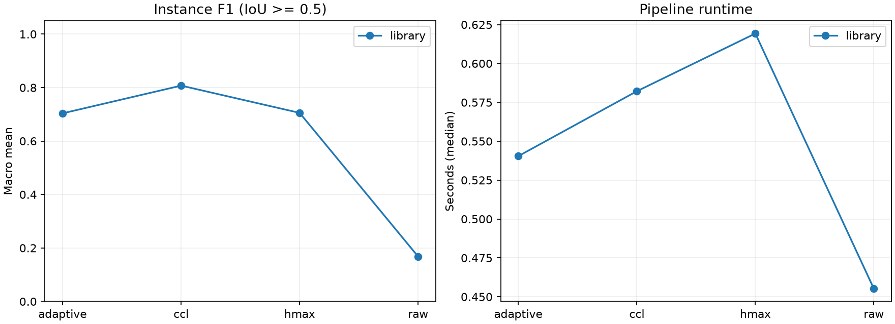
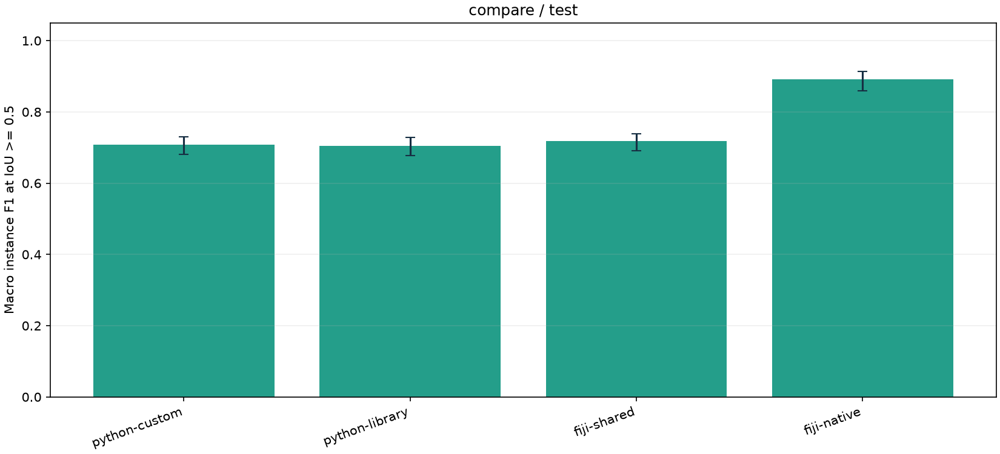

# Kết quả kiểm chứng và benchmark MorphoLab

Đo ngày 08/11/2026 bằng env Miniconda `ai` của máy hiện tại, Python 3.11.18. Tham số và môi trường đầy đủ lưu trong các file `experiment.json` và `study.json` dưới `docs/evidence`. Các mục đầu ghi nhận bản 1.0; mục cập nhật 1.1 bên dưới mở rộng kiểm chứng. Đây là các phép đo của dự án, không phải điểm số được công bố bởi Broad Institute.

## Kiểm tra độ đúng triển khai

14 bài kiểm tra tự động đã qua, gồm morphology với SE bất đối xứng và biên ảnh, reconstruction ảnh xám và tính ổn định, EDT chính xác, liên thông 4/8, h-maxima, Watershed, ảnh rỗng, đổi ID nhãn, split/merge, hai engine và hai bài tích hợp gọi Fiji thật. Không dùng mock để thay thế Fiji. Lệnh:

```bat
python -m unittest discover -s tests -v
```

Kiểm tra tích hợp xác nhận IoU/Dice và số đối tượng do Java/ImageJ tính khớp Python trên cùng ảnh nhãn. Workflow Fiji độc lập cũng xuất các bước co, giãn, mở, đóng, reconstruction, components, distance và marker.

## Ảnh tổng hợp

Tạo 18 ảnh 192×192 với seed cố định 20261108; 6 ảnh validation, 12 ảnh test. Ground truth gồm các đĩa có bán kính biến thiên; vùng giao được phân cho tâm có khoảng cách chuẩn hóa nhỏ nhất. Ảnh có Gaussian blur, biến thiên sáng và ba mức nhiễu. Đây là dữ liệu hình học tổng hợp, không đại diện đầy đủ mô tế bào.

Benchmark kiểm tra trên 3 ảnh validation đầu, 1 warm-up và 2 lượt đo mỗi cấu hình:

| Phương pháp | Macro F1 đối tượng custom | Macro F1 library | Thời gian custom (s) | Thời gian library (s) |
| --- | --- | --- | --- | --- |
| CCL | 0.7210 | 0.7210 | 1.0444 | 0.0411 |
| Raw Watershed | 0.7220 | 0.7220 | 0.7999 | 0.0308 |
| h-maxima | 0.9804 | 0.9804 | 1.0775 | 0.0443 |
| Adaptive | 0.9804 | 0.9804 | 0.9040 | 0.0359 |

F1 ghép đối tượng tại IoU ≥ 0.5. Các phép đo custom ưu tiên khả năng giải thích thuật toán; bản thư viện tận dụng các triển khai native. Không coi chênh lệch thời gian giữa hai bản là một thuật toán mới do nhóm phát minh. Pipeline vẫn tính các ảnh trung gian để phục vụ giao diện, kể cả ở baseline CCL.

Chức năng xử lý thư mục cũng đã chạy thành công trên toàn bộ 18 ảnh tổng hợp; bảng kết quả từng ảnh nằm trong `evidence/synthetic_all.csv`.

## BBBC039 và chọn tham số

BBBC039v1 có 200 ảnh nhân tế bào U2OS 520×696, nhãn thủ công và phân chia chính thức. Phần mềm giữ 100 training, 50 validation và 50 test. Nguồn và giấy phép CC0: [Broad Institute](https://bbbc.broadinstitute.org/BBBC039).

Khảo sát h trên 6 ảnh validation đầu, engine library/hmax, giữ các tham số khác theo `configs/default.json`:

| h | Macro F1 validation |
| --- | --- |
| 0.5 | 0.5546 |
| 1 | 0.6624 |
| 2 | 0.6664 |
| 4 | 0.6501 |
| 6 | 0.6314 |

Chọn h=2 trước khi chạy test. Quy trình chọn này chỉ khảo sát một tham số trên một phần validation; chưa phải tối ưu toàn bộ pipeline. `evidence/selected_parameters.json` giữ cấu hình đã chọn.

## Đánh giá toàn bộ 50 ảnh test BBBC039

Đã chạy đủ bốn phương pháp bằng bản library, mỗi cấu hình 1 warm-up và 2 lượt đo. Thời gian loại đọc/ghi và tính metric; số liệu tổng hợp là macro mean theo ảnh, thời gian là median các median theo ảnh.

| Phương pháp | F1 đối tượng | IoU tiền cảnh | Sai số đếm trung bình | Thời gian (s) |
| --- | --- | --- | --- | --- |
| CCL | 0.8074 | 0.8954 | 24.02 | 0.5822 |
| Raw Watershed | 0.1681 | 0.8954 | 356.50 | 0.4552 |
| h-maxima | 0.7054 | 0.8954 | 21.10 | 0.6193 |
| Adaptive | 0.7038 | 0.8954 | 20.84 | 0.5405 |



IoU tiền cảnh giống nhau vì các phương pháp dùng chung mask và không tạo dams. Raw tạo nhiều marker nên chia quá nhiều. h-maxima giảm sai số đếm so với CCL trên tập này nhưng F1 thấp hơn CCL: số đếm tổng thể gần đúng hơn không đồng nghĩa tách đúng từng vật thể. Adaptive chưa vượt h-maxima về F1. Cần xem lỗi cụ thể, điều chỉnh tiền xử lý và marker trên validation trong các nghiên cứu tiếp theo; không dùng kết quả test để tiếp tục chọn rồi báo lại cùng test như một phép đánh giá độc lập mới.

Hai bản custom/library còn được benchmark trên 2 ảnh validation thật để kiểm tra sự nhất quán và chi phí tính toán. F1 hmax lần lượt 0.6304 và 0.6221; cùng IoU tiền cảnh 0.8778, có chênh lệch ranh giới do xử lý plateau và sai số số thực. Chưa chạy bản custom trên toàn bộ 50 ảnh test. Bảng chi tiết nằm trong `evidence/validation_bbbc039`.

## Đối chiếu Fiji

Với ảnh tổng hợp đầu tiên, giao thức chung elevation/marker/mask đạt độ đồng thuận pixel khoảng 98.48% trong hợp tiền cảnh sau ánh xạ ID. Python và Fiji đều tìm được 7 đối tượng, F1 theo ground truth là 1 trên ảnh này. Khác biệt ranh giới vẫn được giữ trong bản đồ disagreement, không bị che bằng việc so sánh số đếm đơn thuần.

Workflow Fiji độc lập trên cùng ảnh tìm 7 đối tượng, IoU tiền cảnh khoảng 0.9801, Dice khoảng 0.9900 do Java tính. Workflow này dùng SE vuông, lượng tử hóa 8-bit, ImageJ Otsu/EDM và extended maxima; không gọi chênh lệch đầu ra là sai lệch của riêng Watershed. Thời gian native pipeline bao gồm xuất ảnh trung gian, không so trực tiếp với thời gian xử lý Python đã loại IO.

## Tái lập và giới hạn

- `docs/evidence` giữ CSV từng ảnh, summary, biểu đồ và metadata của các thí nghiệm thành công. Dữ liệu ảnh tải lại qua `python -m morpholab dataset bbbc039`.
- Bản 1.0 kiểm chứng Fiji trên ảnh mẫu; bản 1.1 đã chạy đầy đủ trên 50 ảnh test theo mục bên dưới.
- Thời gian phụ thuộc tải máy; các đợt đo có thể chạy đồng thời trong quá trình kiểm chứng. Muốn dùng số thời gian để kết luận tối ưu trong báo cáo, nên đo lại tuần tự trên máy rảnh với nhiều lần lặp hơn.
- Chưa có ablation đầy đủ cho mọi phép hình thái hoặc tối ưu tham số đa chiều. Ứng dụng đã có chức năng để mở rộng thực nghiệm này.
- Báo cáo 30 trang, slides và nộp LMS chưa thuộc phần sản phẩm đã hoàn thành trong lần xây phần mềm này.

## Cập nhật 1.1 và kiểm chứng trên toàn bộ 50 ảnh test

Đã chạy 50 ảnh × 4 cách xử lý = **200 kết quả**, không lỗi. Có một lượt warm-up Python và một lượt đo, không lựa chọn lại tham số theo test. Bản tự cài 1.1 tối ưu khởi tạo reconstruction bằng một lượt giãn đồng bộ, chỉ đưa pixel thay đổi vào hàng đợi. Các test ngẫu nhiên ảnh xám xác nhận đầu ra bằng bản thư viện. So với bản cũ, thời gian không được coi là phép đo speedup có kiểm soát vì hai đợt có tải máy khác nhau.

| Cách chạy | Macro F1 đối tượng | CI mô tả 95% | IoU tiền cảnh | Sai số đếm TB |
| --- | --- | --- | --- | --- |
| Python tự cài | 0.7087 | 0.6807–0.7305 | 0.8954 | 21.10 |
| Python thư viện | 0.7054 | 0.6771–0.7277 | 0.8954 | 21.10 |
| Fiji shared | 0.7188 | 0.6914–0.7386 | 0.8954 | 21.10 |
| Fiji native | 0.8917 | 0.8592–0.9132 | 0.8910 | 13.58 |



Fiji shared dùng đúng địa hình, marker và mask từ Python tự cài; trung vị đồng thuận pixel sau ghép ID khoảng 95.56%. Số lượng đối tượng và IoU tiền cảnh giống nhau nhưng F1 khác nhau do ranh giới và quy tắc đồng mức. Native có lượng tử hóa, mask, SE, distance transform và cách tạo marker riêng; vì vậy điểm cao hơn không chứng minh riêng triển khai Watershed của Fiji tốt hơn về mọi mặt. Cần phân tích từng ảnh trung gian để tìm nguyên nhân.

CI là bootstrap percentile 1000 mẫu trên các ảnh; chỉ mô tả độ biến thiên, không dùng để tuyên bố tính ưu việt thống kê từ các khoảng chồng lấn. Các thời gian được ghi riêng theo phạm vi đo, không trộn thời gian JVM với thời gian kernel xử lý. Tham số và CSV chi tiết nằm trong `evidence/v2_compare_bbbc039_test`.

## Ablation trên 6 ảnh validation

Đã chạy 7 cấu hình × 6 ảnh = 42 kết quả, bản thư viện. Chỉ thay bước nêu trong tên biến thể, các tham số khác giữ nguyên. Mỗi biến thể có warm-up và một lượt đo.

| Biến thể | Macro F1 đối tượng |
| --- | --- |
| Baseline | 0.6664 |
| Bỏ Gaussian | 0.6884 |
| Bỏ hình thái | 0.6664 |
| Opening thường thay reconstruction | 0.6692 |
| Bỏ lấp lỗ | 0.6592 |
| Marker raw | 0.1563 |
| Chỉ CCL | 0.8168 |

Các con số không ủng hộ việc thêm mọi bước luôn làm kết quả tốt hơn: trên 6 ảnh này, bỏ Gaussian tăng F1, còn raw marker giảm mạnh do chia quá nhiều. Reconstruction không tạo khác biệt về F1 so với bỏ hình thái ở cấu hình đã chọn. Đây là khảo sát validation nhỏ, không tự thay đổi cấu hình rồi báo lại test như thể chưa dùng test trước đó.

## Kiểm tra nhiễu và mờ trên 6 ảnh validation

Đã chạy 7 biến thể × 6 ảnh = 42 kết quả, seed 20261108 + chỉ số ảnh; giữ ground truth gốc để đo độ suy giảm. Nhiễu được thêm trên ảnh min–max [0,1], clip [0,1]. Các biến thể có tương quan, không phải 42 ảnh độc lập mới.

| Biến thể | Macro F1 đối tượng | IoU tiền cảnh |
| --- | --- | --- |
| Gốc | 0.6664 | 0.8798 |
| Nhiễu σ=0.02 | 0.6527 | 0.8736 |
| Nhiễu σ=0.05 | 0.6668 | 0.8374 |
| Nhiễu σ=0.10 | 0.6385 | 0.7792 |
| Mờ σ=1 | 0.6689 | 0.8751 |
| Mờ σ=2 | 0.6406 | 0.8616 |
| Mờ σ=3 | 0.6018 | 0.8461 |

Chất lượng mask và chất lượng tách từng vật thể không luôn biến thiên giống nhau. Giữ cả IoU tiền cảnh và F1 đối tượng giúp phân biệt hai vấn đề này. Biểu đồ, CSV và phiếu HTML của hai khảo sát nằm trong `evidence/v2_ablation_bbbc039` và `evidence/v2_robustness_bbbc039`.

## Kiểm tra phần mềm bản 1.1

22 tests đã qua, bổ sung kiểm tra chỉnh marker, lưu/mở phiên, HTML escaping, cấm ghi trộn vào thư mục phiên cũ, tính tái lập stress test, hủy study có lưu kết quả một phần, thu hồi tiến trình con và đóng GUI khi worker đang chạy. Đã kiểm tra trực quan tab nghiên cứu và mở lại số liệu 50 ảnh từ lịch sử trên Windows. Phiên GUI thử tự đóng; không cần giữ app chạy nền để giữ số liệu.
