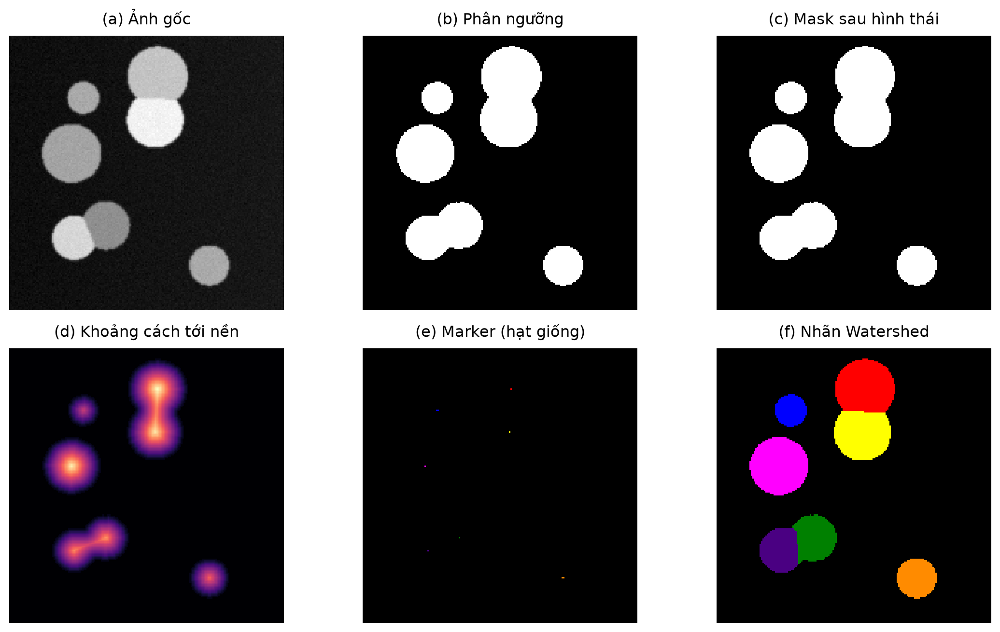
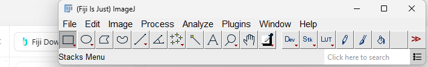
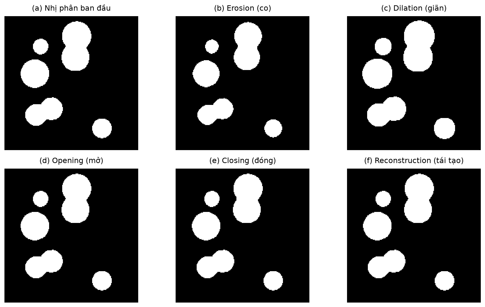
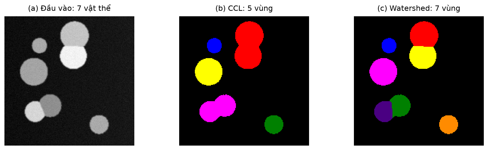

# Thực hành Fiji đầy đủ — từ ảnh gốc đến kết quả bài tập lớn

Đề tài Nhóm 1: **Phân đoạn đối tượng bằng hình thái học toán học và Watershed**, tham chiếu **MorphoLibJ 1.6.5**. Hướng dẫn này giải thích những mục cần dùng và các lựa chọn gần chúng. Không cần dùng hết mọi lệnh Fiji; mỗi lệnh phải phục vụ một bước nghiên cứu cụ thể.

**Nên học theo thứ tự:** mục 1–4 để hiểu ảnh/ngưỡng → mục 5–10 để tự làm quy trình → mục 11 để chạy script Fiji đã kiểm tra → mục 12–14 để đo, khảo sát và viết báo cáo. Mục 15 xử lý lỗi. Nguồn và phạm vi kiểm chứng ở mục 16.

## 1. Kết quả cuối cùng cần đạt là gì?

Input mẫu: `D:\XU_LY_ANH\data\synthetic\synth_00.tif`, ảnh xám 1 kênh, 192×192, 16-bit. Nhãn đúng đi kèm: `synth_00_gt.tif`.

Mục tiêu: từ ảnh gốc tạo một **ảnh nhãn**, nền 0, mỗi vật thể một ID. Ảnh mẫu có **7 vật thể**, gồm hai cặp chạm nhau. Mask chỉ có **5 thành phần liên thông**; sau tạo marker phù hợp và Watershed cần có **7 nhãn**. Không phải nhận biết tên “tế bào”, “hình tròn” hay “con vật”.

```text
Anh goc
  -> chuan hoa va lam tron
  -> nguong: vat the / nen
  -> hinh thai + tai tao + lap lo + loai vung nho
  -> mask sach
  -> distance (khoang cach toi nen)
  -> cuc dai -> marker co nhan
  -> elevation = -distance
  -> Watershed(elevation, marker, mask)
  -> anh nhan + bang doi tuong + diem so voi nhan dung
```



**Ảnh màu là hình minh họa.** Tệp nhãn TIFF chứa ID số mới là dữ liệu để đánh giá. Chỉ đếm đúng 7 chưa đủ chứng minh biên/vùng đúng: cần IoU/Dice và F1 theo đối tượng.

## 2. Mở Fiji, quản lý cửa sổ và giữ ảnh gốc

Mở `C:\Tools\Fiji\fiji-windows-x64.exe`. Thanh công cụ nhỏ là cửa sổ chính. Mỗi ảnh, bảng Results, Log, hộp thoại có thể nằm ở một cửa sổ khác.



| Lệnh | Tác dụng | Cách dùng trong bài |
| --- | --- | --- |
| File → Open; Ctrl+O | Đọc ảnh | Mở `synth_00.tif`, không chọn `binary.tif` làm ảnh gốc |
| Image → Duplicate | Tạo bản sao ảnh/ROI | Tạo một ảnh làm việc, giữ gốc để so sánh |
| Image → Rename | Đặt tên cửa sổ | Đặt `01_work`, `02_binary`, `03_eroded`… tránh chọn nhầm |
| Window | Chuyển giữa ảnh đang mở | Chọn đúng ảnh trước khi gọi lệnh |
| Window → Tile | Sắp xếp các cửa sổ ảnh | So sánh các bước cạnh nhau |
| File → Save As → Tiff | Lưu dữ liệu ảnh | Lưu từng bước vào thư mục kết quả mới |
| Image → Show Info / Properties | Xem kiểu, kích thước, hiệu chuẩn | Ghi 192×192, 16-bit, đơn vị pixel nếu chưa có hiệu chuẩn |
| Analyze → Histogram | Xem phân bố độ sáng | Hiểu nền tối và vật sáng trước khi ngưỡng |
| Edit → Selection → Select None | Bỏ ROI | Thực hành toàn ảnh; ROI đang chọn có thể làm thống kê/phép toán chỉ tác động một vùng |

Tạo thư mục `D:\XU_LY_ANH\outputs\fiji_hand_01` bằng File Explorer. Lưu các kết quả thực hành trong đó. Các lần khảo sát khác dùng `fiji_hand_02`, `fiji_hand_03`…

“No Image” nghĩa là lệnh cần ảnh nhưng chưa có ảnh phù hợp đang mở. Bấm OK, mở/chọn ảnh rồi thực hiện lại. Không phải lỗi cài đặt plugin.

### Kiểu ảnh và màu hiển thị

| Mục Image → Type | Ý nghĩa | Bài này dùng khi nào? |
| --- | --- | --- |
| 8-bit | 256 mức, 0–255 | Baseline Fiji làm trơn/ngưỡng trên ảnh 8-bit |
| 16-bit | Thường ảnh nguyên 0–65535 | Dữ liệu gốc của mẫu; giữ một bản gốc |
| 32-bit | Số thực, có thể âm | Distance, elevation âm, ảnh nhãn có nhiều ID |
| RGB Color | Ba kênh màu | Xuất hình trình bày; không dùng thay nhãn để tính metric |
| Lookup Tables — LUT | Ánh xạ giá trị sang màu hiển thị | Giúp nhìn nhãn 1–7; không cần đổi ID pixel |

Brightness/Contrast chủ yếu thay cách nhìn ảnh xám. Tuy nhiên **chuyển 16/32-bit sang 8-bit có thể dùng khoảng hiển thị hiện tại để đổi dữ liệu**, nên phải ghi quy tắc chuyển đổi. Không tùy tiện tăng sáng, chuyển 8-bit rồi coi là cùng một input như trước.

## 3. Vì sao có Threshold, Auto và Auto Threshold?

Ba tên này liên quan đến cùng bài toán nhưng nằm ở các giao diện khác nhau:

| Chỗ xuất hiện | Là gì? | Bạn dùng thế nào? |
| --- | --- | --- |
| Image → Adjust → Threshold… | Cửa sổ chọn/xem ngưỡng | Chọn phương pháp, xem vùng đỏ, có thể kéo ngưỡng bằng tay |
| Nút Auto trong cửa sổ Threshold | Một thao tác tự tính ngưỡng | Dùng phương pháp đang chọn trong danh sách, không phải một thuật toán riêng |
| Image → Adjust → Auto Threshold | Plugin phân ngưỡng toàn cục | Có lựa chọn histogram, nền/vật thể và có thể tạo mask trực tiếp |
| Image → Adjust → Auto Local Threshold | Ngưỡng cục bộ theo lân cận | Khảo sát thêm khi độ sáng nền không đều; không thuộc baseline hiện tại |

**Không chạy cả Threshold → Apply rồi Auto Threshold tiếp trên cùng mask.** Khi đã nhị phân hóa, phần lớn độ sáng ban đầu đã mất. Muốn so hai cách, tạo hai bản sao từ cùng ảnh xám đã làm trơn.

Với ảnh 16-bit, đừng mặc định hai giao diện cho cùng ngưỡng: plugin Auto Threshold có thể dùng đầy đủ mức xám; cửa sổ Threshold có tùy chọn histogram 16-bit và cách chia histogram phụ thuộc phiên bản/cài đặt. Ghi rõ kiểu ảnh và tùy chọn. Để theo baseline dễ kiểm soát, quy trình bên dưới chủ động chuyển về 8-bit trước. Nguồn: [Auto Threshold](https://imagej.net/plugins/auto-threshold), JAR Auto_Threshold 1.18.0 và ImageJ 1.54p đã cài.

### Từng mục trong cửa sổ Threshold của ảnh bạn gửi

| Mục | Tác dụng | Chọn cho bài mẫu |
| --- | --- | --- |
| Histogram phía trên | Số pixel ở các mức sáng | Dùng hiểu phân bố, không kéo biểu đồ để “tách thêm vật” |
| Thanh trượt giới hạn thấp | Chọn mức sáng bắt đầu thuộc vùng chọn | Sau Auto, để nguyên nếu đang ghi kết quả tự động |
| Thanh trượt giới hạn cao | Chọn mức sáng cuối của vùng chọn | Với vật sáng, thường để mức cao tối đa |
| Danh sách Default/Otsu/… | Thuật toán tính ngưỡng | Chọn **Otsu**; Default là một biến thể IsoData, không phải tên khác của Otsu |
| Danh sách Red/B&W/Over/Under | Cách hiển thị vùng chọn | **Red** dễ xem; không đổi thuật toán |
| Red | Tô vùng được chọn bằng đỏ | Màu đỏ chỉ là preview, không phải ảnh đã trở thành RGB |
| B&W | Preview đen/trắng | Không suy ra giá trị pixel chỉ từ màu LUT |
| Over/Under | Phân biệt phần ngoài khoảng ngưỡng | Dùng kiểm tra vùng bị loại ở hai phía |
| Dark background | Nền tối, vật thể sáng | **Bật** với mẫu này |
| Stack histogram | Tính từ nhiều lát trong stack | **Tắt** khi chỉ làm một ảnh 2D |
| Don't reset range | Giữ khoảng hiển thị khi thao tác ngưỡng | Không phải giữ nguyên ngưỡng; ghi trạng thái nếu làm 16/32-bit |
| Raw values | Hiển thị giá trị thô khi có hiệu chuẩn cường độ | Mẫu không hiệu chuẩn cường độ; không phải nút biến ảnh về dữ liệu gốc |
| 16-bit histogram | Dùng chi tiết histogram 16-bit khi hỗ trợ | Không cần cho quy trình làm trên bản 8-bit |
| Auto | Tính ngưỡng tự động | Bấm sau khi chọn Otsu |
| Apply | Biến lựa chọn thành mask | Làm trên bản sao, xem kiểm tra 0/255 ngay sau đó |
| Reset | Bỏ ngưỡng preview | Không khôi phục được ảnh xám sau khi đã ghi đè bằng Apply |
| Set | Nhập giới hạn ngưỡng bằng số | Dùng thí nghiệm ngưỡng thủ công, ghi rõ không còn Auto nguyên bản |

Tên và hành vi cơ bản đối chiếu [ImageJ Image menu](https://imagej.net/ij/docs/menus/image.html), bổ sung từ mã ThresholdAdjuster/Auto_Threshold của bản cài. Tùy kiểu ảnh/stack, một số ô có thể không hoạt động.

### Các tùy chọn trong plugin Auto Threshold

Nếu chọn plugin thay cho cửa sổ Threshold, dùng một bản sao cùng ảnh xám đã làm trơn:

| Mục | Ý nghĩa | Cấu hình học bài mẫu |
| --- | --- | --- |
| Method | Thuật toán ngưỡng | Otsu |
| White objects on black background | Vật sáng thành 255, nền 0 | Bật |
| Ignore black / Ignore white | Bỏ các bin cực trị khi tính ngưỡng | Tắt cả hai để dùng histogram đầy đủ; đổi thì ghi lại |
| Set Threshold instead of Threshold | Chỉ đặt preview, chưa nhị phân hóa | Tắt nếu muốn tạo mask ngay |
| Stack | Xử lý các lát stack | Tắt cho ảnh đơn |
| Use stack histogram | Một histogram chung cho stack | Tắt cho ảnh đơn |
| Try all trong Method | Khảo sát nhiều phương pháp | Dùng để học trên validation, không chọn theo test rồi báo độc lập |

Khi khảo sát phương pháp cùng cấp: **Otsu** phân chia theo độ biến thiên giữa hai lớp; **IsoData/Default** lặp theo mức sáng hai nhóm; **Triangle** dùng dạng hình học histogram; **Mean** dựa trung bình; **Li/Yen/MaxEntropy** theo các tiêu chí tối ưu khác. Không có phương pháp tốt nhất cho mọi ảnh. Với đề tài này, Otsu là bước tạo mask; trọng tâm nghiên cứu vẫn là hình thái và Watershed.

## 4. Chuẩn bị ảnh xám và làm trơn

Làm trên bản sao của `synth_00.tif`:

1. Bỏ ROI nếu có. Chọn **Image → Duplicate**, đặt `01_work`.
2. Nếu muốn gần giao thức native: xem **Analyze → Histogram**, ghi min/max thật. Mẫu gốc hiện tại có min **2749**, max **64456**.
3. Trong **Image → Adjust → Brightness/Contrast → Set**, đặt min/max hiển thị bằng min/max thật trên bản làm việc. Bật **Scale When Converting** trong **Edit → Options → Conversions**, rồi chọn **Image → Type → 8-bit**. Đây là bước đổi dữ liệu về 0–255; ảnh gốc vẫn giữ ở cửa sổ riêng.
4. Lưu `01_input_8bit.tif`.
5. Chọn **Process → Filters → Gaussian Blur…**, đặt **Sigma = 1**. Lưu `02_smooth.tif`.

| Bộ lọc cùng nhóm | Tác dụng | Vì sao chọn/không chọn ở baseline? |
| --- | --- | --- |
| Gaussian Blur | Làm trơn có trọng số Gaussian | Dùng sigma=1 để giảm nhiễu trước ngưỡng |
| Mean | Trung bình lân cận | Dễ hiểu nhưng làm mờ đều, có thể nhòe biên |
| Median | Trung vị lân cận | Thường hữu ích với nhiễu xung; không thay thế Gaussian mà không ghi thí nghiệm |
| Minimum / Maximum | Lấy min/max cục bộ | Có liên hệ với co/giãn ảnh xám; phải thống nhất footprint |
| Unsharp Mask / Sharpen | Tăng độ nét | Có thể tăng nhiễu; không dùng mặc định trong bài |

Sigma đo theo pixel: lớn hơn thường làm mờ mạnh hơn, có thể mất vật nhỏ hoặc cầu nối thay đổi. Không liên quan số lượng đối tượng cần đếm. Tài liệu: [Process menu](https://imagej.net/ij/docs/menus/process.html).

## 5. Phân ngưỡng để tạo ảnh nhị phân

1. Chọn đúng `02_smooth`.
2. Với cách cửa sổ Threshold, trước khi Apply kiểm tra **Process → Binary → Options → Black background** được bật; mục tiêu dữ liệu là vật=255, nền=0. Những tùy chọn Binary khác chưa cần đổi.
3. **Image → Adjust → Threshold**, chọn **Otsu**, bật **Dark background**, chọn **Red**, không dùng stack. Bấm **Auto**.
4. Quan sát: vùng đỏ có phủ vật thể và ít phủ nền không? Không kéo sửa nếu đang muốn ghi kết quả Otsu tự động.
5. Ghi số ngưỡng, chụp preview; bấm **Apply** để tạo mask. Nếu dùng plugin Auto Threshold, áp dụng cấu hình ở mục 3 thay cho bước này.
6. Đặt tên/lưu `03_binary.tif`.

Kiểm tra bằng di chuột trên vùng vật và nền, đọc giá trị ở thanh trạng thái. Cần thấy 255 và 0. Nếu chỉ LUT bị đảo thì đổi LUT để nhìn; nếu giá trị nền/vật bị đảo thật thì cần đảo pixel hoặc chạy lại với polarity đúng. **Edit → Invert** đổi giá trị; **Image → Lookup Tables → Invert LUT** chỉ đảo cách nhìn.

Ở đây hai hình chạm nhau vẫn là một khối trắng. Threshold chưa làm công việc tách từng vật thể.

## 6. Co, giãn, mở, đóng: chạy đúng từng phép để minh họa

Mở/chọn `03_binary`. Tạo một bản sao cho **mỗi phép**, rồi chọn **Plugins → MorphoLibJ → Filtering → Morphological Filters**.

| Trường trong hộp thoại | Tác dụng | Thí nghiệm đầu |
| --- | --- | --- |
| Operation | Chọn phép toán | Lần lượt Erosion, Dilation, Opening, Closing |
| Element | Hình phần tử cấu trúc — SE | **Square** |
| Radius (in pixels) | Bán kính SE | **1** → Square 3×3 |
| Show Element | Xem SE thực dùng | Có thể bật để học hình dạng |
| Preview nếu có | Xem trước ảnh hiện tại | Dùng kiểm tra trước khi OK |

| Operation cùng cấp | Tác dụng ngắn |
| --- | --- |
| Erosion — co | Thu nhỏ tiền cảnh; có thể loại chấm nhỏ/cầu nối mảnh |
| Dilation — giãn | Mở rộng tiền cảnh; có thể nối các vật gần nhau |
| Opening — mở | Co rồi giãn; thường loại chi tiết/vùng nhỏ |
| Closing — đóng | Giãn rồi co; thường khép khe/lỗ nhỏ, cũng có thể nối vật |
| White Top Hat | Phần sáng nhỏ bị opening loại: ảnh gốc trừ opening |
| Black Top Hat | Phần tối nhỏ được closing lấp: closing trừ ảnh gốc |
| Gradient | Dilation trừ erosion; làm nổi biên |
| Internal / External Gradient | Biên phía trong / phía ngoài |
| Laplacian hình thái | Tổ hợp dilation, erosion và ảnh gốc; khác Laplacian tuyến tính thông thường |

SE cùng cấp: **Square** vuông; **Disk** đĩa xấp xỉ trên lưới; **Diamond** hình thoi; **Octagon** bát giác; các **Line** ưu tiên một hướng. Radius lớn ảnh hưởng vùng lớn hơn, có thể xóa vật nhỏ. Cùng radius nhưng khác SE không phải cùng phép toán. Trong Python, disk r=1 có dạng chữ thập, khác Square 3×3 của native Fiji.

Lưu `04_eroded.tif`, `04_dilated.tif`, `04_opened.tif`, `04_closed.tif`. Không co ảnh rồi giãn tiếp trên cùng cửa sổ để báo đó là “dilation của ảnh gốc”. Phép nối tiếp như vậy đang là opening.



## 7. Tái tạo, lấp lỗ và lọc diện tích

### 7.1 Opening by reconstruction — mở bằng tái tạo

Đảm bảo `03_binary` và `04_eroded` cùng kích thước, còn mở trong Fiji. Chọn **Plugins → MorphoLibJ → Filtering → Morphological Reconstruction**:

| Trường | Chọn | Tác dụng |
| --- | --- | --- |
| Marker Image | `04_eroded` | Nơi còn hạt giống sau co |
| Mask Image | `03_binary` | Giới hạn không cho tái tạo vượt ảnh nhị phân ban đầu |
| Type of Reconstruction | **By Dilation** | Giãn lặp marker dưới giới hạn mask |
| Connectivity | **4** | Lan theo trên/dưới/trái/phải |

By Erosion là tái tạo đối ngẫu bằng co, cần quy ước marker ≥ mask; không chọn thay By Dilation trong workflow này. Marker của reconstruction là **cường độ khởi tạo**, khác marker **ID nhãn Watershed** ở bước sau.

Kết quả giữ lại các vùng còn seed sau co, có thể phục hồi hình dạng gốc. Nó có thể phục hồi cả cầu nối, nên vẫn cần Watershed để tách vật đang dính. Lưu `05_reconstruction.tif`.

### 7.2 Fill Holes — lấp lỗ

Chọn kết quả tái tạo; gọi **Plugins → MorphoLibJ → Filtering → Fill Holes (Binary/Gray)**. Mục tiêu là lấp phần nền kín bên trong vật thể, không phải lấp toàn khoảng trống ngoài vật thể. Lưu `06_filled.tif`.

Lệnh gần nó **Kill Borders** loại các vùng chạm biên. Không chạy trong baseline: ảnh thật có thể có nhân bị cắt ở biên, loại chúng sẽ thay số lượng và metric. Nếu khảo sát thì ghi thành một biến thể riêng.

### 7.3 Lọc vùng quá nhỏ

Trên mask đã lấp lỗ, chọn **Plugins → MorphoLibJ → Binary Images → Size Opening 2D/3D**, đặt **Min Pixel Number = 25** cho ảnh 2D. Nó loại vùng nhỏ hơn ngưỡng diện tích; không giống morphological opening bằng một SE cố định. Khi hộp thoại không cho chọn liên thông, phải ghi quy ước mặc định plugin; script chuẩn ở mục 11 dùng rõ liên thông 4 khi lọc.

Lưu `07_mask.tif`. Mẫu 192×192 chỉ có 36864 pixel; đặt ngưỡng diện tích 100000 sẽ loại hết mọi vùng. Đây là lỗi cấu hình, không phải Watershed bị hỏng.

## 8. Đếm vùng liên thông để có baseline

Chọn `07_mask`, gọi **Plugins → MorphoLibJ → Binary Images → Connected Components Labeling**:

| Trường | Chọn | Vì sao? |
| --- | --- | --- |
| Connectivity | **4** | Giữ quy ước đã chọn; 8 nối thêm các đường chéo |
| Type of result | **float** | Chứa nhiều ID; thuận tiện xử lý tiếp, không có nghĩa ảnh RGB |

Các lựa chọn 8 bits/16 bits dùng ít bộ nhớ hơn nhưng giới hạn số ID biểu diễn. Với ảnh mẫu 7 vật thì loại nào cũng đủ; dùng float để không gặp giới hạn nhỏ khi sang ảnh nhiều nhân.

Lưu `08_components.tif`. Dùng **MorphoLibJ → Analyze → Analyze Regions** để xem mỗi ID một dòng. Ở pipeline chuẩn của mẫu có **5 vùng**, vì hai cặp vật chạm nhau. Đây là baseline để chứng minh bước Watershed giúp được gì trên ví dụ này.

## 9. Tạo distance, marker và elevation

### 9.1 Distance map — khoảng cách tới nền

Chọn lại **mask 07**, không chọn components/nhãn. Để gần baseline native ImageJ:

1. **Process → Binary → Options**, chọn đầu ra EDM **32-bit** nếu có lựa chọn `EDM output`. Giữ đối tượng trắng, nền 0.
2. **Process → Binary → Distance Map**. Kết quả là khoảng cách của mỗi pixel trong vật tới nền, không phải ảnh đếm vật thể.
3. Lưu `09_distance.tif` ở dạng float 32-bit.

MorphoLibJ cũng có **Euclidean Distance Map**, **Chamfer Distance Map**, **Geodesic Distance Map**: Euclid là khoảng cách hình học; Chamfer là xấp xỉ bằng trọng số; Geodesic đo đường đi bị giới hạn trong miền. Chúng không tự được coi là giống EDM native. Các quy ước chuẩn hóa, pixel spacing và xử lý biên phải được ghi; script chuẩn dùng `ImageJ EDM`, background=0 và coi ngoài ảnh là nền.

### 9.2 Extended maxima — cực đại đã lọc theo h

Tạo bản sao từ distance, rồi **Plugins → MorphoLibJ → Minima and Maxima → Extended Min & Max**:

| Trường | Chọn | Tác dụng |
| --- | --- | --- |
| Operation | **Extended Maxima** | Tìm các vùng cực đại nổi đủ mức h |
| Dynamic | **2** | Mức h; với distance theo pixel, đây là đơn vị khoảng cách |
| Connectivity | **4** | Dùng cùng quy ước lân cận |

Lưu `10_maxima.tif` — đây vẫn là ảnh vùng cực đại nhị phân. Chạy **Connected Components Labeling** lên nó, connectivity=4, Type=float, lưu `11_markers.tif`. Ở ví dụ chuẩn cần có **7 marker**.

Tăng Dynamic thường bỏ nhiều cực đại nông hơn, có thể thiếu marker và gộp vật. Giảm quá nhiều có thể sinh thừa marker/chia thừa. Đừng nhập 7 vào Dynamic vì “muốn tìm 7 vật”: Dynamic không phải số lượng đích.

Các lựa chọn cùng nhóm: **Regional Min & Max** tìm cực trị chưa lọc mức h; **Extended Minima** tìm vùng trũng đủ độ sâu; **Impose Min & Max** ép địa hình có cực trị theo marker cho bài toán khác. Không chạy tất cả nối tiếp. Nếu thành phần mask không có marker, pipeline code thêm seed tại nơi distance lớn nhất; thao tác tay cần kiểm tra/bổ sung hoặc dùng script để áp dụng cùng quy tắc.

### 9.3 Elevation — địa hình để Watershed ngập từ tâm

Từ **09_distance**, Duplicate thành `12_elevation`. Kiểm tra nó là **32-bit**. Chọn **Process → Math → Multiply…**, nhập **-1**, OK. Lưu `12_elevation.tif`.

Tâm vật có distance lớn; sau nhân -1, tâm thành vùng thấp. **Không dùng Invert LUT thay cho nhân -1**: Invert LUT chỉ đổi màu nhìn, không tạo địa hình âm thật. Edit → Invert cũng không được mặc định bằng `-distance`, vì có thể dùng một phép đổi dựa trên min/max.

## 10. Chạy Marker-controlled Watershed và xem kết quả

Mở/giữ cả `12_elevation`, `11_markers`, `07_mask`. Chọn **Plugins → MorphoLibJ → Segmentation → Marker-controlled Watershed**:

| Mục trên MorphoLibJ 1.6.5 | Chọn | Ý nghĩa |
| --- | --- | --- |
| Input | `12_elevation` | Địa hình để lan nhãn |
| Marker | `11_markers` | Các ID vùng khởi tạo |
| Mask | `07_mask` | Chỉ phân đoạn trong tiền cảnh; None sẽ cho chạy toàn miền |
| Compactness | **0** | Không thêm ưu tiên hình dạng gọn; tăng sẽ đổi tiêu chí chia vùng |
| Binary markers | **Bỏ tích** | Marker đã mang ID; bật khi cung cấp marker nhị phân cần gán nhãn lại |
| Calculate dams | **Bỏ tích** | Không tạo đường chia mang giá trị nền giữa hai nhãn |
| Use diagonal connectivity | **Bỏ tích** | 2D liên thông 4; bật là liên thông 8 |

Bấm OK; lưu **`13_labels.tif`**. Kỳ vọng trên mẫu chuẩn: **7 ID dương**. Đổi LUT màu để nhìn cho dễ, giữ ID pixel khi lưu.

| Các lệnh Segmentation cùng cấp | Khác nhau thế nào? |
| --- | --- |
| Classic Watershed | Tự dựa vào các vùng trũng; thường nhạy nhiễu/chia thừa |
| Marker-controlled Watershed | Bạn cung cấp marker để điều khiển số vùng khởi tạo; dùng trong bài |
| Interactive Marker-controlled Watershed | Hỗ trợ tương tác đặt/sửa marker; cần phân biệt kết quả thủ công với tự động |
| Morphological Segmentation | Giao diện workflow rộng hơn, có tiền xử lý/gradient; không phải đúng nguyên pipeline đang so |
| Distance Transform Watershed ở Binary Images | Lối tắt từ mask đến tách bằng khoảng cách; tiện demo nhưng có quy ước riêng về distance/h/connectivity |



**Menu bằng tay nhằm hiểu từng bước.** Không bảo đảm từng pixel trùng native code nếu khác khoảng chuyển 8-bit, độ chính xác Gaussian, ngưỡng bao gồm/không bao gồm T, thuật toán distance, quy tắc biên, lọc diện tích hoặc seed dự phòng. Muốn tái lập chính xác baseline đã đo, chạy script sau và so TIFF, không chỉ so số vùng.

## 11. Script Fiji chạy trọn quy trình từ ảnh gốc — đã kiểm tra

Đây là **code Groovy chạy trong Fiji**, không cần mở MorphoLab và không gọi Watershed Python.

1. Tạo thư mục **mới, trống** `D:\XU_LY_ANH\outputs\fiji_full_01` bằng Explorer.
2. Trong Fiji chọn **File → New → Script** để mở Script Editor.
3. Trong editor chọn **File → Open**, mở `D:\XU_LY_ANH\fiji\Full_Pipeline_Tutorial.groovy`.
4. Chọn **Language → Groovy**, bấm **Run**.
5. Ở hộp nhập tham số chọn:

| Trường | Chọn |
| --- | --- |
| Anh xam dau vao | `D:\XU_LY_ANH\data\synthetic\synth_00.tif` |
| Thu muc MOI de luu ket qua | `D:\XU_LY_ANH\outputs\fiji_full_01` |
| Hien cac buoc trong Fiji | Bật để xem từng bước; tắt nếu chỉ muốn lưu file |

6. Chờ Log báo **Full Fiji pipeline completed: 7 objects**. Script lưu các TIFF, `parameters.txt` và `fiji_metrics.csv`. Có thể dùng Window → Tile; nhiều cửa sổ chỉ là ảnh trung gian.
7. Mở folder kết quả. Xem `native_binary`, `native_mask`, `native_components`, `native_distance`, `native_maxima`, `native_markers`, `native_elevation`, `morpholibj_labels`. Các ảnh native erosion/dilation/opening/closing/reconstruction cũng được lưu.

Cấu hình cố định: min–max về [0,1] → 8-bit; Gaussian sigma=1/accuracy=0.01; Otsu; Square r=1; reconstruction liên thông 4; fill holes mặc định plugin; min_area=25; ImageJ float EDM; h=2; liên thông 4; dams tắt; compactness=0. Xem số ngưỡng thực trong `parameters.txt`.

Script đã chạy thật trên máy bằng Groovy và JAR Fiji; **12 TIFF trùng từng giá trị với native Java baseline** trong ví dụ mẫu. Kết quả kiểm tra:

| Đo | Kết quả chuẩn native của ảnh mẫu |
| --- | --- |
| Ngưỡng Otsu 8-bit | **100** |
| Thành phần của mask | **5** |
| Marker | **7** |
| Nhãn Watershed | **7** |
| IoU tiền cảnh | **0.98013245** |
| Dice tiền cảnh | **0.98996656** |
| F1 theo đối tượng, ghép IoU ≥ 0.5 | **1.0** |

Ground truth chỉ được đọc **sau khi phân đoạn** để tính metric. Script tìm tệp cùng thư mục `tenanh_gt.tif`; nếu không có thì chỉ báo số dự đoán, không tự bịa điểm chính xác. Với ảnh thật khác, không có cam kết tìm đúng 7.

**Đừng nhầm hai bảng:** Python/shared có IoU khoảng 0.981397, native Fiji ở đây khoảng 0.980132. Cả hai F1=1 trên mẫu nhưng mask có thể khác. Đây là hai quy trình đã mô tả, không phải thay đổi nhãn đúng.

## 12. Đếm, đo diện tích và chấm kết quả

### Bảng hình học trong Fiji

Chọn ảnh **nhãn cuối**, rồi **Plugins → MorphoLibJ → Analyze → Analyze Regions**. Chọn các Features cần nghiên cứu như Area, Centroid, Bounding box, các đặc trưng hình dạng tùy phiên bản. Một dòng tương ứng một nhãn; mẫu cần 7 dòng. Lưu bảng bằng menu File/Save As của cửa sổ bảng, dùng CSV.

| Đại lượng/lệnh | Dùng để làm gì? |
| --- | --- |
| Area | Diện tích vùng; pixel² nếu chưa hiệu chuẩn vật lý |
| Centroid | Tâm hình học; phân biệt x là cột, y là hàng |
| Bounding Box | Hộp bao vùng |
| Equivalent Ellipse / Max. Feret Diameters | Mô tả hướng, độ dài/hình dạng |
| Intensity Measurements 2D/3D | Đo cường độ vùng trên ảnh xám tương ứng |
| Analyze → Set Scale | Đặt đơn vị vật lý khi biết kích thước pixel; không tự nhập để “đẹp” số liệu |
| Analyze → Measure | Đo ảnh/ROI đang chọn; không mặc định trả bảng từng ID Watershed |
| Analyze Particles trên mask | Đếm vùng nhị phân còn nối nhau; có thể vẫn là 5, không thay bảng nhãn 7 đối tượng |

### IoU/Dice và F1

IoU/Dice tiền cảnh đo vùng vật/nền; F1 theo đối tượng còn phạt chia/gộp. Cùng mask nhưng 5/7 nhãn có thể có IoU giống nhau và F1 khác nhau.

Script đầy đủ xuất `fiji_metrics.csv` do Groovy/ImageJ tính IoU/Dice/count. Để chấm nhãn Fiji bằng code nhóm, trong Anaconda Prompt:

```bat
conda activate ai
cd /d D:\XU_LY_ANH
python -m morpholab evaluate data\synthetic\synth_00_gt.tif outputs\fiji_full_01\morpholibj_labels.tif --out outputs\fiji_full_01\python_metrics.json
```

Kỳ vọng số native trong bảng mục 11. So `fiji_metrics.csv` với `python_metrics.json`: IoU/Dice/count phải khớp trong sai số làm tròn; F1/PQ do Python ghép từng đối tượng. Nếu thao tác tay, thay đường dẫn dự đoán bằng `outputs\fiji_hand_01\13_labels.tif` và giữ điểm thực tế, không ép về con số mẫu.

MorphoLibJ có **Analyze → Label Overlap Measures** với Source/Target và các lựa chọn Jaccard, Dice, overlap, false positive/negative. Không dùng trực tiếp ID tùy ý giữa hai ảnh instance rồi mặc định điểm đó là F1 Hungarian của project. Muốn kiểm tra tiền cảnh bằng plugin, tạo hai bản sao **nhị phân** từ GT>0 và prediction>0 với cùng 0/255, chạy overlap trên chúng. Đọc rõ quy tắc của từng chỉ số, không đổi Jaccard thành F1. Không ghi đè nhãn gốc khi nhị phân hóa.

Để tự bấm phép đo tiền cảnh này trong Fiji:

1. Mở `data/synthetic/synth_00_gt.tif` và nhãn dự đoán. Duplicate mỗi ảnh, đặt `gt_fg`, `pred_fg`.
2. Với mỗi bản sao, dùng Threshold → **Set**: giới hạn thấp=1, cao=ID lớn nhất (mẫu này là 7), rồi Apply với vật trắng/nền đen. Không dùng Otsu để tạo mask từ ID nhãn: ID không phải cường độ vật thể. Kiểm tra các vùng ID dương đều thành 255.
3. Chọn **MorphoLibJ → Analyze → Label Overlap Measures**. Source=`gt_fg`, Target=`pred_fg`; bật **Jaccard index** và **Dice coefficient**, OK.
4. Đọc/lưu bảng tổng hợp. Với script chuẩn native, Jaccard khoảng 0.98013245, Dice khoảng 0.98996656. Hai binary mask đã dùng cùng nhãn tiền cảnh; phép đo không còn phụ thuộc cách đánh ID từng nhân.
5. Quay lại hai ảnh nhãn gốc để tính F1 theo đối tượng bằng lệnh Python. Nhị phân hóa xong sẽ không còn thông tin phân biệt từng nhân nên không dùng các bản `*_fg` để chấm F1 instance.

## 13. Ghi lại thao tác, tự động hóa và khảo sát

Mở **Plugins → Macros → Record…** trước khi thao tác. Recorder ghi lệnh và tùy chọn của các plugin hỗ trợ ghi; lưu `.ijm` để xem lại. Các thao tác GUI không phải lúc nào cũng được ghi đầy đủ; chạy lại trên bản sao để xác nhận. Groovy Script Editor là một lựa chọn tự động hóa khác, đã có script toàn pipeline ở mục 11.

Sau khi làm được cấu hình gốc, chỉ thay **một yếu tố mỗi thí nghiệm**, giữ input/GT và các thứ khác cố định:

| Thí nghiệm | Thay gì? | Quan sát/đo gì? |
| --- | --- | --- |
| Baseline CCL vs Watershed | Bước tách cuối | Số nhãn, F1, gộp vật thể |
| Raw vs h-maxima | Marker chưa lọc và đã lọc | Số marker, chia thừa, F1 |
| h | 0.5, 1, 2, 4, 6 trên validation | Đường biến thiên F1/count, không chọn từ test |
| SE | Square vs Disk; radius 1/2/3 | Mất vật nhỏ, nối/gãy cầu, IoU/F1 |
| Gaussian | Sigma=0/1/2 | Nhiễu/cực đại, biên bị mờ |
| Morphology | Không dùng / opening thường / reconstruction | Tác động thật, có thể không cải thiện |
| Dams | Tắt vs bật | Pixel đường chia đổi mask; phải công bố khi so |
| 4 vs 8 | Liên thông | Các tiếp xúc chéo và đường chia |

Các tùy chọn không phải để bật hết. Mỗi thay đổi phải có lý do và file cấu hình/nhật ký. Các thí nghiệm đầy đủ sẵn trong `docs/evidence/v2_compare_bbbc039_test`, `v2_ablation_bbbc039`, `v2_robustness_bbbc039`; 50 ảnh test × 4 cách là 200 dòng kết quả, không phải 200 ảnh test độc lập.

## 14. Đạt yêu cầu bài tập lớn bằng những minh chứng nào?

| Thầy yêu cầu | Việc làm trong Fiji/Python | Mang vào báo cáo |
| --- | --- | --- |
| Lý thuyết rõ và sâu | Giải thích SE, reconstruction, distance, marker, Watershed, CCL | Công thức, ví dụ tính tay, quy ước biên và độ phức tạp |
| Khảo sát plugin | Tự chạy các menu ở mục 5–10; đối chiếu script | Tên plugin/phiên bản, tham số, ảnh trung gian |
| Tự cài thuật toán | Chạy bản custom của nhóm và trình bày code | Phân biệt phần tự cài với Gaussian/Otsu/IO dùng thư viện |
| Định lượng hai phía | Fiji/Groovy CSV + Python metrics + nhãn đúng | IoU/Dice/F1/PQ/count, lỗi chia/gộp; không chỉ ảnh màu |
| Thực nghiệm/benchmark/cải tiến | Nhiều ảnh, validation chọn tham số, test đánh giá | Bảng từng ảnh, tổng hợp, biểu đồ, môi trường và giới hạn thời gian |
| Báo cáo ~30 trang, slide ~10 | Dùng bộ hồ sơ đã dựng và đọc hiểu kết quả | Báo cáo LaTeX, 10 slide, link repo và mã Nhóm 1 |

Một bộ kết quả cho **một ảnh** nên có: ảnh gốc, binary, mask, distance, marker, nhãn TIFF, hình overlay, bảng đối tượng CSV, điểm so GT, file tham số/nhật ký. Một ảnh demo đẹp chưa đủ đại diện ảnh thật.

Kịch bản bảo vệ: mở gốc → chỉ CCL=5 → giải thích distance/marker → Watershed=7 → mở Fiji/script và ảnh nhãn → đối chiếu điểm hai phía → mở bảng 50 test → phân tích một kết quả xấu và giới hạn. Không cần chạy cả 50 ảnh ngay trong lớp.

## 15. Chẩn đoán khi làm không ra kết quả

| Vấn đề | Nguyên nhân thường gặp | Làm gì tiếp? |
| --- | --- | --- |
| Mở ảnh gốc đã trắng/đen | Chọn nhầm `binary.tif` | Mở `data/synthetic/synth_00.tif` |
| Vùng đỏ phủ nền | Polarity hoặc ngưỡng sai | Kiểm tra Dark background và min/max ngưỡng |
| Đóng Threshold thì đỏ biến mất | Đó mới là preview | Apply trên bản sao nếu muốn lưu mask |
| Sau Apply gần hết trắng/đen | Sai ảnh/sai khoảng ngưỡng hoặc đảo nền | Kiểm tra pixel0/255 và ảnh đang chọn |
| Auto Threshold khác Auto | Kiểu ảnh/bins/Ignore black-white khác | Cùng ảnh 8-bit, cùng phương pháp và tùy chọn rồi so |
| Morphology làm mất vật | Radius/min_area quá lớn | Về mặc định, xem từng bước để xác định nơi mất |
| Có 5 nhãn thay vì 7 | Đang xem CCL hoặc thiếu marker | Xem `native_markers` và chọn đúng Input/Marker/Mask |
| Có quá nhiều nhãn | Marker quá dày/nhiễu | Xem h-maxima và Gaussian; khảo sát h trên validation |
| Kết quả nhãn gần đen | ID nhỏ, LUT chưa dễ nhìn | Đổi LUT/reset display range, không threshold lại nhãn |
| Count đúng nhưng F1 thấp | Vùng sai/gộp/chia dù tổng đếm trùng | Xem ghép đối tượng và mask, không chỉ count |
| Script báo folder không trống | Đang chọn đầu ra của lần trước | Tạo thư mục mới; không chọn thư mục chứa ảnh gốc |
| Không có điểm chính xác | Thiếu nhãn đúng hoặc không đúng tên | Chọn GT tương ứng khi `evaluate`; không tự gán F1 |
| Điểm khác số mẫu | Khác pipeline/cấu hình | Xem parameters và kiểu dữ liệu; dùng script chuẩn để tái lập |

## 16. Nguồn và phạm vi kiểm tra

- [ImageJ Image menu](https://imagej.net/ij/docs/menus/image.html): loại ảnh, hiển thị và cửa sổ Threshold.
- [Auto Threshold](https://imagej.net/plugins/auto-threshold) và [Auto Local Threshold](https://imagej.net/plugins/auto-local-threshold): cách hai plugin dùng histogram/lân cận.
- [ImageJ Process menu](https://imagej.net/ij/docs/menus/process.html), [Analyze menu](https://imagej.net/ij/docs/menus/analyze.html): lọc ảnh, phép toán và đo.
- [MorphoLibJ](https://imagej.net/plugins/morpholibj), manual 1.6.5 đã tải và `plugins.config`/các lớp trong JAR cài tại `C:/Tools/Fiji`: tên menu, trường hộp thoại, SE và toán tử.
- Code của nhóm: `NativePipeline.java`, `MorphoBridge.java`, `Full_Pipeline_Tutorial.groovy`, `morpholab/metrics.py`. Các ví dụ tác động tham số và cách diễn giải gắn với dữ liệu/cài đặt của dự án.
- Script toàn pipeline đã kiểm tra bằng Groovy/Fiji thật với **showStages=false**: đầu ra 12 TIFF trùng native baseline trên ảnh mẫu, count/F1/IoU/Dice đã đối chiếu; biên bản tại `docs/evidence/academic_verification/fiji_tutorial_pipeline.json`. Hướng dẫn thao tác tay dựa menu/API thực; chưa tuyên bố đã tự động click thử mọi menu và mọi tùy chọn GUI.

Ảnh giao diện được dùng để minh họa; số liệu kết quả lấy từ TIFF và CSV. Khi bạn chạy tay ra kết quả khác, giữ dữ liệu đó và tìm nguyên nhân trước khi đổi kết luận trong báo cáo.
