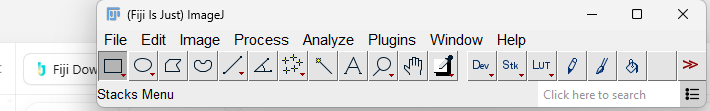
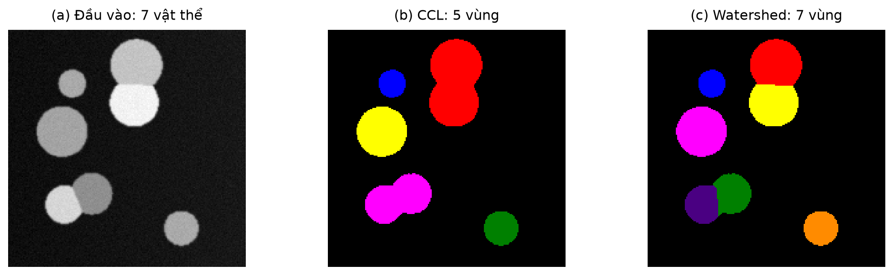

# Thực hành Fiji lần đầu — làm lần lượt 6 bước

Bạn đã chạy Python thành công và có thư mục `D:\XU_LY_ANH\outputs\demo_shared\fiji`. Bây giờ mục tiêu là **tự bấm trong Fiji để tách ảnh thành 7 vật thể**, rồi lưu kết quả. Các bước dưới đây chưa cần mở app MorphoLab.

## Bước 1 — Mở Fiji

Nhấp đúp `C:\Tools\Fiji\fiji-windows-x64.exe`. Cửa sổ Fiji nhỏ như thanh công cụ là đúng, không phải mở lỗi. Ảnh sẽ nằm trong những cửa sổ riêng.



Nếu có thông báo **No Image / There are no images open**, bấm OK. Thông báo này nghĩa là bạn vừa gọi một chức năng cần ảnh nhưng chưa mở ảnh. Tiếp tục bước 2.

## Bước 2 — Mở đúng 3 ảnh

Trong Fiji chọn **File → Open** (hoặc Ctrl+O), mở lần lượt:

```text
D:\XU_LY_ANH\outputs\demo_shared\fiji\elevation.tif
D:\XU_LY_ANH\outputs\demo_shared\fiji\markers.tif
D:\XU_LY_ANH\outputs\demo_shared\fiji\mask.tif
```

Lặp File → Open ba lần. Dùng menu **Window** để chuyển giữa các ảnh đã mở.

| Ảnh | Vai trò | Bạn cần hiểu gì? |
| --- | --- | --- |
| elevation | Địa hình âm khoảng cách tới nền | Quy định thứ tự lan nhãn |
| markers | Hạt giống, mỗi ID khởi tạo một vùng | Giúp tách những vật thể đang chạm nhau |
| mask | Vùng tiền cảnh | Không cho nhãn lan ra nền |

Ảnh markers có thể gần như đen vì các ID chỉ từ 1 đến 7; không có nghĩa tệp bị lỗi. Để xem màu, dùng **Image → Lookup Tables** chọn một LUT hoặc **Image → Adjust → Brightness/Contrast**. Giữ nguyên dữ liệu khi lưu, không chuyển RGB để chấm.

## Bước 3 — Gọi Watershed

Chọn **Plugins → MorphoLibJ → Segmentation → Marker-controlled Watershed**.

Nếu chưa thấy lệnh, dùng ô tìm kiếm lệnh trong Fiji và gõ `Marker-controlled Watershed`. Chọn đúng lệnh này; không chọn `Classic Watershed` hay `Distance Transform Watershed` vì đó là các quy trình khác.

Trong hộp thoại đặt:

| Trường | Chọn |
| --- | --- |
| Input image | `elevation.tif` |
| Marker image | `markers.tif` |
| Mask image | `mask.tif` |
| Use diagonal connectivity | **Bỏ tích** → liên thông 4 trong ảnh 2D |
| Binary markers | **Bỏ tích** vì markers.tif đã chứa ID nhãn |
| Calculate dams | **Bỏ tích** |
| Compactness | `0` |

Đây là tên trường trong MorphoLibJ 1.6.5 đã cài trên máy. Nếu bản khác có danh sách Connectivity thay vì ô diagonal, chọn `4`.

Bấm **OK**. Fiji phải tạo một ảnh kết quả mới. Với ví dụ này, kết quả cần có **7 nhãn đối tượng**. ID màu có thể khác Python; xem vùng nào được chia, không đối chiếu chỉ bằng màu.



## Bước 4 — Lưu ảnh kết quả

Bấm vào cửa sổ **ảnh kết quả Watershed** để nó là ảnh đang chọn, rồi chọn **File → Save As → Tiff**.

Lưu vào:

```text
D:\XU_LY_ANH\outputs\demo_shared\fiji\fiji_manual_labels.tif
```

Đây là dữ liệu nhãn để kiểm tra, không chỉ là ảnh chụp màn hình. Không lưu đè elevation/markers/mask. Giữ ảnh nhãn gốc, không đổi thành RGB.

## Bước 5 — Đọc điểm của ảnh Fiji

Quay lại Anaconda Prompt đang có `(ai) D:\XU_LY_ANH>`, dán **một dòng**:

```bat
python -m morpholab evaluate data\synthetic\synth_00_gt.tif outputs\demo_shared\fiji\fiji_manual_labels.tif --out outputs\demo_shared\fiji\manual_metrics.json
```

Kỳ vọng:

- `true_objects: 7`: nhãn đúng có 7 vật thể.
- `predicted_objects: 7`: Fiji tìm được 7 vùng nhãn.
- `object_f1: 1.0`: ghép đúng đủ 7 đối tượng theo tiêu chí của dự án.
- `foreground_iou` xấp xỉ `0.981397`, `foreground_dice` xấp xỉ `0.990611`.

F1 bằng 1 ở ví dụ này không có nghĩa chính xác 100% trên mọi ảnh. Ảnh thật trong báo cáo có kết quả khác và được thống kê trên nhiều ảnh.

Mở `outputs/demo_shared/fiji/fiji_metrics.csv`: đây là IoU, Dice và số vùng do **Java/ImageJ tính độc lập** trong phép chạy tự động trước đó. Tệp `manual_metrics.json` là phép chấm ảnh Fiji vừa lưu bằng code Python của nhóm. Hai tệp cho phép trình bày định lượng ở cả hai phía.

## Bước 6 — Đưa gì vào báo cáo và demo?

Ghi tên input, ba ảnh đầu vào, liên thông 4, dams tắt, số nhãn và F1. Khi trình bày, nói:

> “Ảnh mẫu có 7 vật thể, gồm hai cặp chạm nhau. CCL chỉ tìm được 5 vùng liên thông. Watershed có marker tách thành 7 đối tượng. Nhóm chạy lại cùng elevation/marker/mask trên MorphoLibJ trong Fiji, lưu ảnh nhãn và đối chiếu định lượng.”

Báo cáo LaTeX đã có một chương Fiji riêng, bảng thiết lập, hình minh họa, mã Groovy và phần phân biệt Fiji shared/native. Hình/bảng/chương đều được đánh số tự động, tra trong mục lục thay vì đếm số trang trên trình duyệt.

## Khi muốn chạy tự động trong Fiji

Mở **File → New → Script**; chọn **Language → Groovy**. Mở tệp:

```text
D:\XU_LY_ANH\outputs\demo_shared\fiji\Run_in_Fiji.groovy
```

Bấm **Run**. Kết quả hiện trong Fiji và lưu thành `fiji_interactive_labels.tif` trong thư mục đó. Chấm bằng cùng lệnh `evaluate`, thay tên tệp dự đoán. Đây là cách chạy script; bạn vẫn nên làm qua menu một lần để hiểu ba đầu vào.

Muốn xem các phép co/giãn/mở/đóng: mở mask, **Image → Duplicate**, rồi **Plugins → MorphoLibJ → Filtering → Morphological Filters**. Chọn từng phép trên các bản sao của cùng mask ban đầu, SE vuông bán kính 1. Nếu chạy nối tiếp trên một cửa sổ, bạn đang ghép phép toán chứ không còn so từng phép với cùng input.

Nếu chưa tạo `demo_shared`, quay lại [hướng dẫn chạy đầy đủ](HUONG_DAN_CHAY_VA_TEST.md), mục 3. Các TIFF kết quả nghiên cứu độc lập `native_*.tif` được tạo khi chạy `--fiji-native`.
